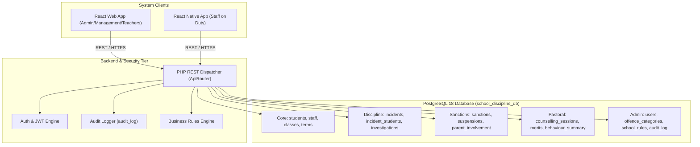

# Student Discipline Management System (SDMS)
## System Actors & Use Cases Comprehensive Analysis

---

## 1. Executive Summary & Architectural Overview

The **Student Discipline Management System (SDMS)** is an enterprise educational conduct governance platform built on a 3-tier client-server architecture:
1. **Persistence Layer:** PostgreSQL 18 relational database with 17 normalized (3NF) tables, strict referential integrity constraints, check constraints, and non-hard-delete retention policies.
2. **Business & API Layer:** PHP REST API featuring stateless token authentication (Bcrypt hashing, JWT), policy-based role authorization, automatic PostgreSQL `audit_log` event generation, and transactional multi-table mutations.
3. **Client Presentation Tier:**
   - **Web Frontend:** React 18 Single Page Application (Vite) designed for desktop administrative workflows, disciplinary committees, dossiers, and term conduct reports.
   - **Mobile Frontend:** React Native (Expo) optimized for rapid on-the-move incident logging by duty teachers, security officers, and prefects.

This document presents a complete, rigorous analysis of **all system actors** and **every functional use case**, categorized into **Implemented**, **Partially Implemented**, and **Not Yet Implemented (Future Scope)**, with an extensive deep-dive into the **Administrator** role.

---

## 2. Complete Inventory of System Actors

The SDMS domain identifies **10 distinct actors** across three tiers: Primary Human Roles, External Subject Actors, and Autonomous System Daemons.

| # | Actor Name | Actor Type | Scope of Authority & Operational Boundary |
|---|---|---|---|
| **1** | **Administrator** | Primary Human Role (`Administrator`) | Complete system governance, tenant management, user credentials/IAM, academic calendar, rules/penal code, audit forensics, and database health. |
| **2** | **Head Teacher** | Primary Human Role (`Head Teacher`) | Chief executive educational officer; full institutional visibility; approves Grave sanctions (Suspensions & Expulsions); views confidential counselling files; final arbiter for appeals. |
| **3** | **Deputy Head Teacher** | Primary Human Role (`Deputy Head Teacher`) | Head of discipline operations; chairs Disciplinary Committee hearings; issues standard sanctions; escalates suspension recommendations to Head Teacher. |
| **4** | **Discipline Master** | Primary Human Role (`Discipline Master`) | Day-to-day discipline coordinator; investigates incidents; summons students/witnesses; issues standard penalties (detention, manual work, written warnings); oversees suspension return conditions. |
| **5** | **Counsellor** | Primary Human Role (`Counsellor`) | Pastoral care specialist; conducts student counselling sessions; records privileged/confidential notes; formulates behavioural rehabilitation contracts. |
| **6** | **Class Teacher** | Primary Human Role (`Class Teacher`) | Academic & conduct guardian of a specific class stream; reports class infractions; monitors class merit/demerit tallies; endorses term conduct evaluations. |
| **7** | **Reporting Staff** | Supporting Human Role (`Teaching` / `Non-Teaching`) | General teachers, laboratory technicians, matrons, wardens, and security guards reporting infractions on mobile or web. |
| **8** | **Student (Learner)** | Subject Actor (`students`) | Subject of disciplinary tracking; involved in incidents as Offender, Victim, Witness, or Accomplice; receives sanctions, merits, and counselling. |
| **9** | **Parent / Guardian** | External Stakeholder (`parent_involvement`) | Recipient of disciplinary notifications (calls, SMS, summons); signs behavioural pledges; accompanies student upon suspension re-entry. |
| **10** | **System Engine / Daemon** | Autonomous Actor (`System Daemon`) | Background triggers for demerit accumulation, threshold alerts, audit event streaming, and term summary rollups. |

---

## 3. Deep-Dive: Administrator Use Cases

The **Administrator** possesses full operational and technical authority. Below is an exhaustive breakdown across 8 functional modules.

### Module A: Identity & Access Management (IAM)
| Use Case ID | Use Case Name | Status | Implemented Details / Technical Gap |
|---|---|---|---|
| **UC-ADM-01** | Authenticate via Secure Credentials | **IMPLEMENTED** | Bcrypt hash verification, JWT token issuance, login logged to `audit_log`. |
| **UC-ADM-02** | View All User Accounts | **IMPLEMENTED** | `GET /api/users` returns user accounts with roles, full names, active status. |
| **UC-ADM-03** | Provision New Staff User Account | **NOT YET IMPLEMENTED** | `POST /api/users` endpoint needs creation; requires pairing with existing `staff` row, assigning username, initial temporary password, and role selection. |
| **UC-ADM-04** | Update User Role & Access Privileges | **NOT YET IMPLEMENTED** | `PUT /api/users/{id}` endpoint and UI to promote/reassign roles (e.g. Class Teacher to Discipline Master). |
| **UC-ADM-05** | Deactivate / Suspend User Account | **NOT YET IMPLEMENTED** | Toggling `users.is_active = FALSE` without hard delete; immediate JWT token invalidation. |
| **UC-ADM-06** | Reset User Password & Force Password Change | **NOT YET IMPLEMENTED** | Administrative password overwrite with secure temporary pass; `must_change_password` flag. |

### Module B: Academic Calendar & Term Orchestration
| Use Case ID | Use Case Name | Status | Implemented Details / Technical Gap |
|---|---|---|---|
| **UC-ADM-07** | View Terms List & Current Academic Term | **IMPLEMENTED** | `GET /api/terms` returns all terms; `terms.is_current` identified in dashboard and sidebar. |
| **UC-ADM-08** | Create Academic Term | **NOT YET IMPLEMENTED** | `POST /api/terms` with Academic Year, Term Name (Term 1/2/3), Start Date, End Date. |
| **UC-ADM-09** | Switch / Activate Current Term | **NOT YET IMPLEMENTED** | Atomic transaction: set current `is_current = FALSE`, update selected `is_current = TRUE`. |
| **UC-ADM-10** | Term Rollover & Archival Transition | **NOT YET IMPLEMENTED** | End-of-term conduct summary freezing; generating baseline `behaviour_summary` rows for the new term. |

### Module C: Academic Hierarchy & Class Configuration
| Use Case ID | Use Case Name | Status | Implemented Details / Technical Gap |
|---|---|---|---|
| **UC-ADM-11** | View All Classes & Enrolled Streams | **IMPLEMENTED** | `GET /api/classes` returns class name, stream, school level, teacher ID, capacity. |
| **UC-ADM-12** | Create Class & Stream | **NOT YET IMPLEMENTED** | `POST /api/classes` to add new grade streams (e.g., "Senior 4 East", "Primary 6 Blue"). |
| **UC-ADM-13** | Assign / Reassign Class Teacher | **NOT YET IMPLEMENTED** | `PUT /api/classes/{id}` to update `class_teacher_id` with foreign key integrity. |
| **UC-ADM-14** | Manage Class Enrollment Capacity | **NOT YET IMPLEMENTED** | Setting stream capacity and preventing student overflow during enrollment. |

### Module D: Disciplinary Penal Code & Rules Management
| Use Case ID | Use Case Name | Status | Implemented Details / Technical Gap |
|---|---|---|---|
| **UC-ADM-15** | View Offence Categories & Demerits | **IMPLEMENTED** | `GET /api/offence-categories` with severity level and demerit points weighting. |
| **UC-ADM-16** | View School Rules Catalog | **IMPLEMENTED** | `GET /api/school-rules` with rule text, prescribed sanction, applicable level. |
| **UC-ADM-17** | Create / Edit Offence Categories | **NOT YET IMPLEMENTED** | `POST /api/offence-categories` and `PUT` to adjust penalty weighting (e.g. Bullying demerits). |
| **UC-ADM-18** | Create / Edit School Rules | **NOT YET IMPLEMENTED** | `POST /api/school-rules` to define institutional regulations and sanction guidelines. |
| **UC-ADM-19** | Deactivate / Sunset Obsolete Rules | **NOT YET IMPLEMENTED** | Toggling `school_rules.is_active = FALSE` without breaking existing incident references. |

### Module E: Audit Trail & Forensic Compliance
| Use Case ID | Use Case Name | Status | Implemented Details / Technical Gap |
|---|---|---|---|
| **UC-ADM-20** | View System Audit Logs | **IMPLEMENTED** | `GET /api/audit-logs` displayed in Web UI with user, action, table, record ID, and timestamp. |
| **UC-ADM-21** | Filter Audit Logs by User / Action / Date | **PARTIALLY IMPLEMENTED** | Basic table search implemented; advanced date range and action filter queries needed in API. |
| **UC-ADM-22** | Export Compliance Audit Report | **NOT YET IMPLEMENTED** | Exporting immutable audit logs to CSV/PDF for Board of Governors or Ministry of Education inspection. |
| **UC-ADM-23** | Investigate Unauthorized Access Attempts | **NOT YET IMPLEMENTED** | Dedicated view for failed login attempts (401 events) and permission denials. |

### Module F: Master Data Governance (Students & Staff)
| Use Case ID | Use Case Name | Status | Implemented Details / Technical Gap |
|---|---|---|---|
| **UC-ADM-24** | Enroll New Student | **IMPLEMENTED** | `POST /api/students` modal in Web UI with admission number, class, level, gender, DOB. |
| **UC-ADM-25** | View 360-Degree Student Conduct Dossier | **IMPLEMENTED** | `GET /api/students/{id}` composite endpoint with incident history, sanctions, merits, summaries. |
| **UC-ADM-26** | Update Student Enrollment Status | **NOT YET IMPLEMENTED** | Status transitions (`Active`, `Transferred`, `Graduated`, `Withdrawn`) preserving conduct history. |
| **UC-ADM-27** | Bulk Student Ingestion | **NOT YET IMPLEMENTED** | Uploading CSV spreadsheets for new intake enrollments with validation. |
| **UC-ADM-28** | Staff Onboarding & Profile Management | **NOT YET IMPLEMENTED** | `POST /api/staff` and `PUT /api/staff/{id}` to manage teaching and non-teaching personnel. |

### Module G: System Policy & Business Rule Parameters
| Use Case ID | Use Case Name | Status | Implemented Details / Technical Gap |
|---|---|---|---|
| **UC-ADM-29** | Configure Demerit Referral Threshold | **NOT YET IMPLEMENTED** | Parameterizing demerit limit (e.g., 5 demerits) that triggers automatic counselling. |
| **UC-ADM-30** | Configure Communication Gateways | **NOT YET IMPLEMENTED** | Setting up SMS/Email credentials for automated parent summons and suspension alerts. |
| **UC-ADM-31** | Administrative Sanction Override / Void | **NOT YET IMPLEMENTED** | Emergency administrative void of wrongful sanction order with mandatory justification note in `audit_log`. |

### Module H: Database Health & Maintenance
| Use Case ID | Use Case Name | Status | Implemented Details / Technical Gap |
|---|---|---|---|
| **UC-ADM-32** | Inspect Database Tables & Schema | **IMPLEMENTED** | `GET /api/tables` displays all 17 tables and active 3NF schema verification. |
| **UC-ADM-33** | Verify Seed Counts & Data Volume | **IMPLEMENTED** | `GET /api/seed-status` displays live row counts across all operational tables. |
| **UC-ADM-34** | Trigger Backup & Disaster Recovery Test | **NOT YET IMPLEMENTED** | Administrative trigger for PostgreSQL `pg_dump` snapshot generation. |
| **UC-ADM-35** | Educational Data Retention Enforcement | **IMPLEMENTED** | Strict business rule: no hard DELETE permitted on discipline tables; soft-status preservation. |

---

## 4. Complete Use Cases for Other System Actors

### 4.1 Head Teacher
| UC ID | Use Case Description | Implemented? | Notes |
|---|---|---|---|
| **UC-HT-01** | Review school-wide conduct metrics & KPIs | **YES** | Live overview with grade distributions, open incidents, and sanctions. |
| **UC-HT-02** | Approve / Issue Grave Sanctions (Suspension & Expulsion) | **YES** | Rule 2 enforced: only Head Teacher, Deputy, or Admin can issue suspensions. |
| **UC-HT-03** | Inspect Confidential Counselling Session Records | **YES** | Rule 5 enforced: `is_confidential = TRUE` sessions visible to Counsellor & Head Teacher. |
| **UC-HT-04** | Review and Determine Disciplinary Sanction Appeals | **NO** | Workflow for student/parent appeal submission, review, and status update (`Appealed`). |
| **UC-HT-05** | Endorse and Sign Official Termly Conduct Sheets | **PARTIALLY** | Print conduct dossier is active; formal electronic signature/seal not yet implemented. |
| **UC-HT-06** | Receive Escalated High-Severity Incident Alerts | **NO** | Real-time push/email alert when a "Grave" incident (e.g. Arson, Weapons) is logged. |

### 4.2 Deputy Head Teacher
| UC ID | Use Case Description | Implemented? | Notes |
|---|---|---|---|
| **UC-DHT-01** | Convene and Chair Disciplinary Committee Hearings | **PARTIALLY** | Status can be transitioned to `'Heard'`; formal committee attendee roster not yet stored. |
| **UC-DHT-02** | Assign Incident Investigators | **PARTIALLY** | `investigations` table exists in DB schema; UI assignment form pending implementation. |
| **UC-DHT-03** | Issue Standard Disciplinary Orders | **YES** | Issues Written Warnings, Detentions, Manual Work via Web modal. |
| **UC-DHT-04** | Monitor Suspension Progression | **YES** | Tracks active suspensions and checks whether return conditions are satisfied. |

### 4.3 Discipline Master
| UC ID | Use Case Description | Implemented? | Notes |
|---|---|---|---|
| **UC-DM-01** | Triage and Review New Incident Reports | **YES** | Incident feed on Web and Mobile with status, category, location, and involved students. |
| **UC-DM-02** | Transition Incident Status (`Reported` → `Under Investigation` → `Heard` → `Closed`) | **YES** | Action buttons on incidents table to update workflow status. |
| **UC-DM-03** | Record Accused Student / Witness Statements | **YES** | Initial statement captured during incident reporting; additional statements in DB. |
| **UC-DM-04** | Log Formal Disciplinary Investigation Findings | **NO** | `investigations` table has `findings`, `recommendations`, `completion_date`; dedicated UI form needed. |
| **UC-DM-05** | Verify Parent Communication Before Suspension Execution | **PARTIALLY** | Rule 3: `suspensions.parent_informed` flag tracked; parent contact logging UI pending. |
| **UC-DM-06** | Record Learner Re-Admission After Suspension | **NO** | Updating `suspensions.actual_return` date and verifying return condition compliance. |

### 4.4 Counsellor (Guidance Officer)
| UC ID | Use Case Description | Implemented? | Notes |
|---|---|---|---|
| **UC-CO-01** | Schedule Pastoral Counselling Session | **YES** | Dedicated Web modal to link session to student and optional incident. |
| **UC-CO-02** | Document Issues Discussed & Agreed Rehabilitation Plan | **YES** | Stores root causes, behavioural triggers, and agreed student commitments. |
| **UC-CO-03** | Track Upcoming Follow-Up Dates | **YES** | Follow-up date logged and displayed in counselling register. |
| **UC-CO-04** | Receive Automated Referrals for Repeat Offenders | **NO** | Auto-flagging students whose total demerits cross threshold (Rule 6). |
| **UC-CO-05** | Mark Confidentiality Flag on Sensitive Disclosures | **YES** | `is_confidential` default TRUE; protected by backend policy authorization. |

### 4.5 Class Teacher
| UC ID | Use Case Description | Implemented? | Notes |
|---|---|---|---|
| **UC-CT-01** | Report Infraction for Assigned Class Students | **YES** | Available on both Web portal and Mobile application. |
| **UC-CT-02** | View Class-Specific Student Conduct Roll | **PARTIALLY** | Class filter is present on students table; backend auto-scoping to `linked_id` class pending. |
| **UC-CT-03** | Award Merits & Commendations for Exemplary Behaviour | **YES** | Awards points (+1, +2, +3, +5) with justification and student attribution. |
| **UC-CT-04** | Add Remarks to End-of-Term Conduct Evaluations | **NO** | Form to enter narrative remarks into `behaviour_summary.remarks`. |
| **UC-CT-05** | Print Individual Student Conduct Sheets for Parents | **YES** | Clean printable conduct dossier modal available on student table. |

### 4.6 Reporting Staff (Duty Teacher / Non-Teaching)
| UC ID | Use Case Description | Implemented? | Notes |
|---|---|---|---|
| **UC-STF-01** | Authenticate on Mobile Device | **YES** | Responsive React Native login with role badges and credential validation. |
| **UC-STF-02** | Rapidly Report Incident On-the-Move | **YES** | Mobile tab for instant incident logging with location, category, date, and narrative. |
| **UC-STF-03** | Search & Filter Recent Incident Log | **YES** | Mobile search by keywords, students, locations, and severity pills (Grave to Minor). |
| **UC-STF-04** | Track Status of Personally Reported Infractions | **PARTIALLY** | Filter for `reported_by = currentUser` pending dedicated mobile toggle. |

### 4.7 Student (Subject Actor)
| UC ID | Use Case Description | Implemented? | Notes |
|---|---|---|---|
| **UC-STU-01** | Provide Statement in Disciplinary Hearing | **YES** | Captured in `incident_students.statement` during incident lifecycle. |
| **UC-STU-02** | Serve Prescribed Sanction (Detention / Manual Work) | **YES** | Tracked through `sanctions.status` (`Pending` → `Ongoing` → `Completed`). |
| **UC-STU-03** | Fulfill Suspension Return Conditions | **PARTIALLY** | Stored in `suspensions.conditions_for_return`; verification workflow pending. |
| **UC-STU-04** | Earn Merit Commendations | **YES** | Positive points awarded and accumulated in `behaviour_summary.total_merits`. |
| **UC-STU-05** | Student Conduct Self-Service Portal | **NO** | Future consideration: read-only student portal to view personal merit/demerit ledger. |

### 4.8 Parent / Guardian
| UC ID | Use Case Description | Implemented? | Notes |
|---|---|---|---|
| **UC-PAR-01** | Receive Incident / Suspension Summons Notification | **PARTIALLY** | Tracked in database table `parent_involvement`; automated SMS/Email gateway pending. |
| **UC-PAR-02** | Attend Disciplinary Conference / Hearing | **PARTIALLY** | Contact method `'Meeting'` recorded in `parent_involvement`. |
| **UC-PAR-03** | Submit Parent Response / Undertaking | **PARTIALLY** | Field `parent_response` in schema; dedicated intake form pending. |
| **UC-PAR-04** | Accompany Suspended Student upon Re-Entry | **YES** | Prerequisite condition enforced by school return protocol. |

### 4.9 Autonomous System Daemon
| UC ID | Use Case Description | Implemented? | Notes |
|---|---|---|---|
| **UC-SYS-01** | Auto-Log Audit Records on Data Mutations | **IMPLEMENTED** | All logins, student creations, incidents, sanctions, merits logged with user & timestamp. |
| **UC-SYS-02** | Demerit & Merit Auto-Accumulation | **PARTIALLY** | Increments `behaviour_summary` totals; needs automated cron/trigger for real-time sync. |
| **UC-SYS-03** | Demerit Threshold Auto-Trigger for Counselling | **NOT YET IMPLEMENTED** | Business Rule 6: auto-creating pending counselling sessions when threshold is breached. |
| **UC-SYS-04** | Suspension Return Overdue Alert | **NOT YET IMPLEMENTED** | Flagging students who have not returned past `expected_return` date. |

---

## 5. Implementation Status Matrix & Gap Analysis

### High-Priority Gaps for Next Development Phase:
1. **Admin User Management UI (UC-ADM-03, 04, 05, 06):** Full interface to onboard staff users, assign roles, reset passwords, and toggle active status.
2. **Academic Calendar Orchestration (UC-ADM-08, 09, 10):** Admin interface to create new terms, toggle the active term, and initiate term-end conduct rollovers.
3. **Formal Investigation Module (UC-DM-04, UC-DHT-02):** UI for assigning investigators and documenting detailed findings and recommendations before hearings.
4. **Parent Involvement Logging Interface (UC-PAR-01, UC-DM-05):** Dedicated portal to log phone calls, SMS notices, formal letters, and parent responses.
5. **Automated Demerit Threshold Referral Trigger (UC-SYS-03 / Rule 6):** Database trigger or backend event handler that auto-creates counselling sessions when a student crosses the configured demerit ceiling.
6. **Class-Teacher Scope Enforcement (UC-CT-02):** Backend policy check ensuring Class Teachers only access records for learners in their assigned class stream.
